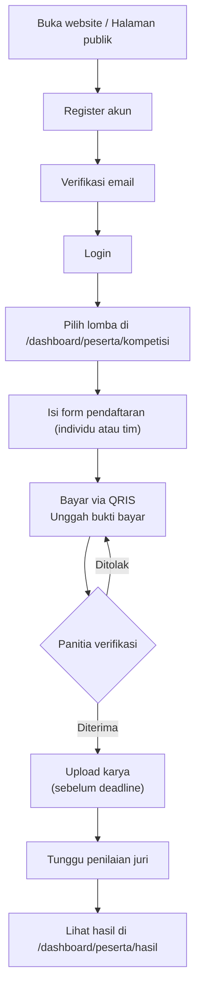
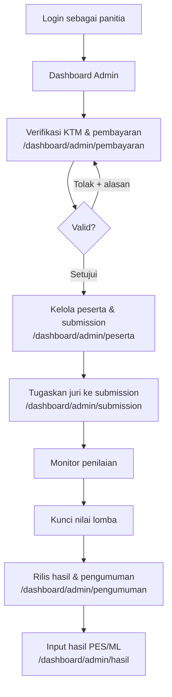
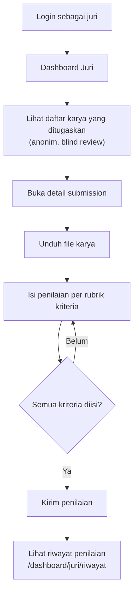
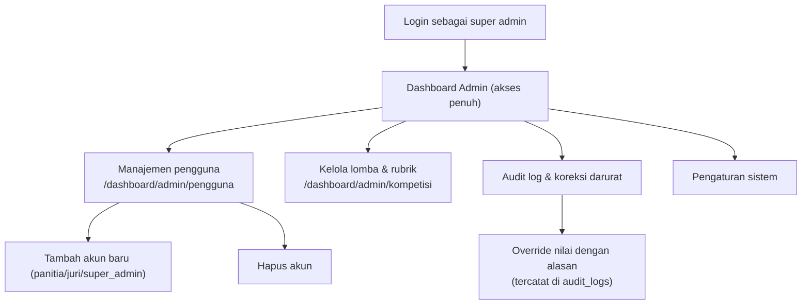
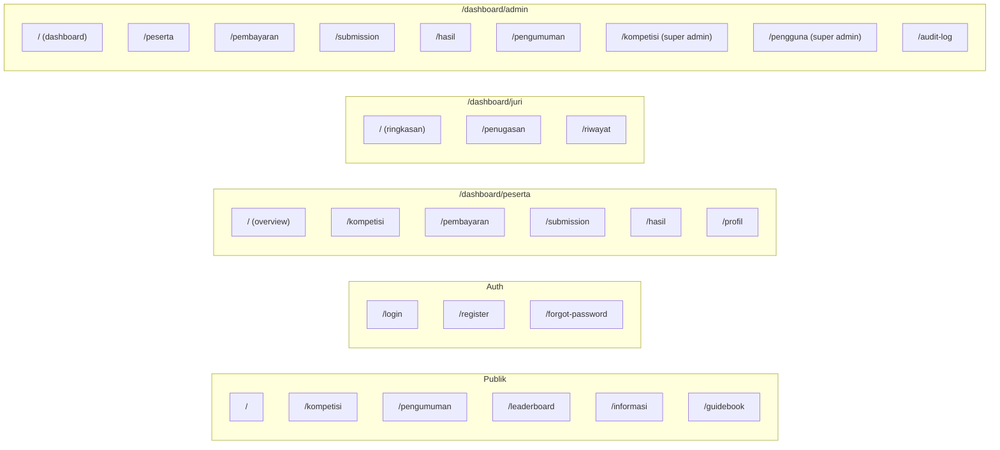

# Permifest x Deforkafest 2026

> Platform web satu pintu untuk lomba **Permifest x Deforkafest** — event kolaborasi **Permikomnas Yogyakarta** × **IMPSI UST Yogyakarta**.

[](https://nextjs.org)
[](https://react.dev)
[](https://supabase.com)
[](https://tailwindcss.com)
[](https://vercel.com)

---

## Daftar Isi

- [Deskripsi](#deskripsi)
- [Cabang Lomba](#cabang-lomba)
- [Stack Teknis](#stack-teknis)
- [Flow Alur Per Peran](#flow-alur-per-peran)
- [Peta Rute Aplikasi](#peta-rute-aplikasi)
- [Cara Setup Dev](#cara-setup-dev)
- [Perintah Useful](#perintah-useful)
- [Akun Demo](#akun-demo)
- [Struktur Folder](#struktur-folder)
- [Deployment](#deployment)
- [Kontribusi](#kontribusi)

---

## Deskripsi

Platform ini menggantikan proses manual (form Google, transfer bank, WhatsApp) dengan satu alur digital: peserta mendaftar, membayar via QRIS, mengunggah karya, dan melihat hasil — semuanya di satu tempat. Panitia memverifikasi, juri menilai lewat rubrik per lomba, dan sistem menghitung nilai akhir otomatis.

**Lima cabang lomba:**

| # | Nama | Tipe | Penilaian |
|---|---|---|---|
| 1 | Esai | Akademik | Rubrik juri |
| 2 | UI/UX Design | Akademik | Rubrik juri |
| 3 | IT System Architecture | Akademik | Rubrik juri |
| 4 | PES (Pro Evolution Soccer) | Non-Akademik | Hasil diinput panitia |
| 5 | Mobile Legends | Non-Akademik | Hasil diinput panitia |

---

## Stack Teknis

| Layer | Teknologi |
|---|---|
| Framework | Next.js 16.4.6 (App Router, Webpack) |
| UI | React 19.3.0 + Tailwind CSS v4 + Phosphor Icons |
| Backend / DB | Supabase — Postgres + Auth + Storage |
| ORM / Query | Supabase JS SDK (repository pattern) |
| Validasi | Zod |
| State | React `useState` + Server Actions |
| Hosting | Vercel |
| Auth | Supabase Auth (email + password) |

---

## Flow Alur Per Peran

### Peserta



**Ringkasan langkah:**
1. Register → verifikasi email → login.
2. Dashboard peserta → pilih lomba → isi form pendaftaran.
3. Halaman pembayaran → scan QRIS → upload foto/scan bukti bayar.
4. Tunggu verifikasi panitia (notifikasi status muncul di dashboard).
5. Jika disetujui → halaman submission → upload file karya (PDF/DOCX) atau link Figma.
6. Pantau status di dashboard; hasil akhir muncul setelah panitia merilis.

---

### Panitia



**Ringkasan langkah:**
1. Login → dashboard admin.
2. Tinjau unggahan bukti bayar; setujui atau tolak dengan alasan.
3. Pantau daftar submission yang masuk per lomba.
4. Tugaskan juri ke submission akademik.
5. Setelah semua nilai masuk → kunci nilai → rilis pengumuman.
6. Untuk lomba non-akademik (PES/ML) → input hasil pertandingan secara manual.

---

### Juri



**Ringkasan langkah:**
1. Login → dashboard juri → lihat ringkasan penugasan.
2. Halaman penugasan → pilih karya yang belum dinilai.
3. Unduh karya; identitas peserta disembunyikan (blind review).
4. Isi nilai per kriteria sesuai rubrik lomba.
5. Submit penilaian → nilai masuk ke sistem; tidak bisa diubah setelah kunci.

---

### Super Admin



**Ringkasan langkah:**
1. Login → akses semua fitur admin + fitur eksklusif super_admin.
2. Manajemen pengguna: buat akun panitia/juri/super_admin, hapus akun.
3. Kelola konfigurasi lomba, field form, dan rubrik penilaian.
4. Jika diperlukan: koreksi darurat nilai lewat fungsi override (wajib isi alasan, tercatat).
5. Pantau audit log seluruh sistem.

> **Catatan keamanan:** Peran `super_admin`, `panitia`, dan `juri` **hanya bisa dibuat oleh super_admin** lewat dashboard. Registrasi publik selalu menghasilkan peran `peserta`.

---

## Peta Rute Aplikasi



---

## Cara Setup Dev

### Prasyarat

- Node.js ≥ 20
- npm ≥ 10
- Supabase CLI (untuk reset DB lokal)

### Langkah

```bash
# 1. Clone repo
git clone https://github.com/harukato588/Permifest-x-Deforkavest-.git
cd Permifest-x-Deforkavest-

# 2. Install dependencies
npm install

# 3. Salin dan isi env vars
cp .env.example .env.local
# Edit .env.local — isi tiga variabel berikut:
#   NEXT_PUBLIC_SUPABASE_URL=...
#   NEXT_PUBLIC_SUPABASE_ANON_KEY=...
#   SUPABASE_SERVICE_ROLE_KEY=...

# 4. Reset database lokal (terapkan migrasi + seed)
npx supabase db reset

# 5. Jalankan dev server
npm run dev
# → http://localhost:3005
```

### Environment Variables

| Variabel | Keterangan | Letak |
|---|---|---|
| `NEXT_PUBLIC_SUPABASE_URL` | URL project Supabase | Klien + Server |
| `NEXT_PUBLIC_SUPABASE_ANON_KEY` | Anon key (aman di klien) | Klien + Server |
| `SUPABASE_SERVICE_ROLE_KEY` | Service role key — **jangan expose ke klien!** | Server only |

> **Penting:** `SUPABASE_SERVICE_ROLE_KEY` hanya boleh diimpor lewat `lib/supabase/admin.ts` yang sudah diproteksi `import "server-only"`.

---

## Perintah Useful

```bash
npm run dev            # Jalankan dev server (port 3005)
npm run lint           # Lint dengan ESLint
npm run typecheck      # Type-check TypeScript (tsc --noEmit)
npm run test           # Unit test (Vitest/Jest)
npm run test:e2e       # E2E test Playwright per peran
npm run build          # Production build (harus lulus sebelum PR)
npm run db:seed:demo   # Provision akun demo ke Supabase
npx supabase db reset  # Reset DB lokal + terapkan migrasi
```

---

## Akun Demo

> Gunakan untuk testing lokal. **Jangan gunakan di production.**

| Peran | Email | Password |
|---|---|---|
| Peserta | `peserta@permifest.id` | `Password123!` |
| Juri | `juri.cyber@permifest.id` | `Password123!` |
| Panitia | `panitia@permifest.id` | `Password123!` |
| Super Admin | `admin@permifest.id` | `Password123!` |

---

## Struktur Folder

```
Permifest-x-Deforkavest-/
├── src/
│   ├── app/                        # Rute Next.js App Router
│   │   ├── (public)/               # Halaman publik (/, /kompetisi, dll.)
│   │   ├── login/ register/        # Halaman auth
│   │   └── dashboard/
│   │       ├── peserta/            # Dashboard peserta
│   │       ├── juri/               # Dashboard juri
│   │       └── admin/              # Dashboard panitia & super admin
│   ├── features/                   # Domain features
│   │   ├── auth/                   # Login, register, session
│   │   ├── users/                  # Manajemen pengguna (super admin)
│   │   ├── registrations/          # Pendaftaran lomba
│   │   ├── payments/               # Upload & verifikasi bukti bayar
│   │   ├── submissions/            # Upload & review karya
│   │   ├── scoring/                # Penilaian juri & rubrik
│   │   └── announcements/          # Pengumuman & leaderboard
│   ├── lib/
│   │   ├── auth/                   # getCurrentUser(), requirePermission()
│   │   ├── supabase/               # Client, admin client, server client
│   │   ├── repositories/           # Abstraksi akses data (supabase | mock)
│   │   └── log.ts                  # Logger (tanpa data pribadi)
│   └── components/                 # Komponen UI bersama
├── supabase/
│   ├── migrations/                 # Migrasi database (jangan edit yang sudah diterapkan)
│   └── seed.sql                    # Data seed lokal
├── docs/                           # Dokumen desain dan arsitektur
│   ├── PRD.md                      # Product Requirements Document
│   ├── SCHEMA.md                   # Skema 22 tabel + RLS + Storage
│   ├── SITEMAP_RBAC.md             # Peta rute & matriks izin
│   ├── SECURITY.md                 # Checklist keamanan & runbook
│   ├── DESIGN_SYSTEM.md            # Token, tipografi, komponen
│   ├── UI_KIT.md                   # Template layar per peran
│   ├── ARCHITECTURE.md             # Lapisan & alur data
│   ├── TESTING.md                  # Strategi & matriks uji
│   ├── TASKS.md                    # Backlog tugas bertahap
│   └── DECISIONS.md                # ADR & pertanyaan terbuka
├── .agents/                        # Konfigurasi agent AI (skills, rules)
├── AGENTS.md                       # Kontrak kerja untuk AI agent
├── CHANGELOG.md                    # Riwayat perubahan
└── package.json
```

---

## Deployment

Proyek di-deploy ke **Vercel** dari branch `master`.

### Langkah deploy:

1. Push ke `master` → Vercel otomatis trigger build.
2. Pastikan tiga environment variable berikut ada di **Vercel Dashboard → Settings → Environment Variables:**

| Variabel | Lingkungan |
|---|---|
| `NEXT_PUBLIC_SUPABASE_URL` | Production, Preview, Development |
| `NEXT_PUBLIC_SUPABASE_ANON_KEY` | Production, Preview, Development |
| `SUPABASE_SERVICE_ROLE_KEY` | Production, Preview (server only) |

3. Vercel akan menjalankan `npm run build` secara otomatis.

> **Checklist sebelum deploy ke production:**
> - [ ] `npm run lint` lulus
> - [ ] `npm run typecheck` lulus
> - [ ] `npm run test` lulus
> - [ ] `npm run build` lulus lokal
> - [ ] Tidak ada `console.log` di kode produksi
> - [ ] Tidak ada rahasia (secret key) di kode atau commit

---

## Kontribusi

Ikuti aturan di [`AGENTS.md`](./AGENTS.md) dan [`docs/TASKS.md`](./docs/TASKS.md).

**Konvensi commit:**

```
feat:     Fitur baru
fix:      Perbaikan bug
docs:     Perubahan dokumentasi
refactor: Refaktor tanpa perubahan fitur
test:     Penambahan atau perbaikan test
chore:    Perubahan konfigurasi, build, atau dependency
```

**Alur kerja:**
1. Ambil satu tugas `[ ]` dari `docs/TASKS.md` → ubah jadi `[~]`.
2. Buat branch fitur → implementasi → jalankan lint + typecheck + test.
3. Update `docs/` dan `CHANGELOG.md` yang relevan.
4. Buat PR kecil → tandai tugas `[x]` setelah merge.

---

*Platform ini dibuat untuk mendukung kelancaran event Permifest x Deforkafest 2026. Dibuat dengan ❤️ oleh tim developer Permikomnas Yogyakarta × IMPSI UST Yogyakarta.*
