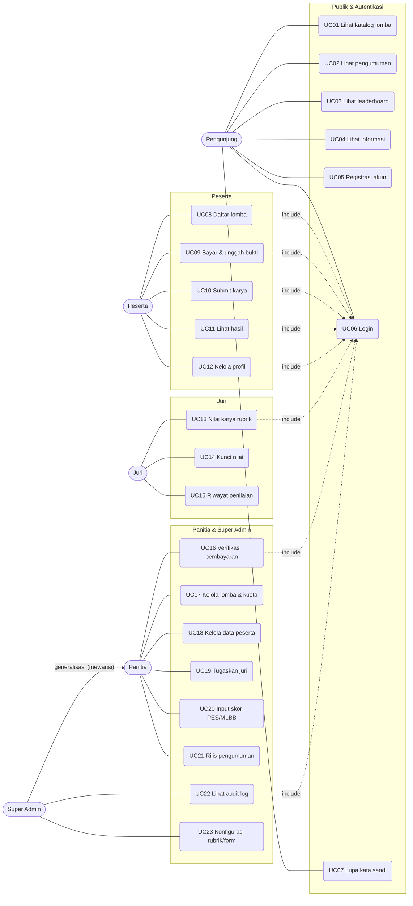
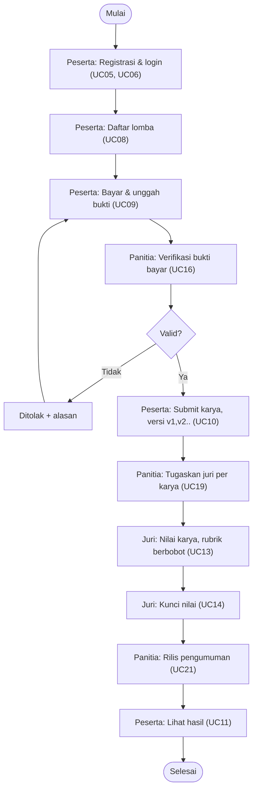
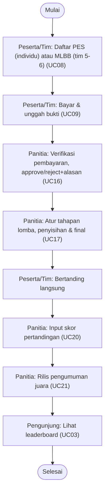

# Spesifikasi Use Case — Permifest × Devorkafest 2026

> **Petunjuk untuk agen AI:** Dokumen ini adalah sumber kebenaran fungsional. Setiap entitas punya ID stabil
> (`UCxx`, `ACT_*`, `COMP_*`, `ST_*`, `RULE_*`). Gunakan ID tersebut saat merujuk, membuat kode, tes, atau tiket.
> Item bertanda `[ASUMSI]` BUKAN fakta dari sumber — verifikasi ke kode/PRD sebelum dijadikan aturan keras.
> Jangan mengarang use case, aktor, atau rute di luar yang tercantum di sini.

## 0. Ringkasan satu paragraf

Platform web satu pintu untuk mengelola kompetisi bertema Cybersecurity. Cakupan: registrasi mandiri,
pembayaran QRIS/transfer, pengumpulan karya, penilaian rubrik oleh juri, input skor turnamen e-sport,
pengumuman, serta administrasi oleh panitia dan super admin. Ada **2 jalur alur**: *akademik* (karya + juri)
dan *e-sport* (skor diinput panitia, tanpa karya dan tanpa juri).

---

## 1. Aktor

```yaml
actors:
  - id: ACT_VISITOR
    name: Pengunjung
    auth: false
    description: Pengguna umum belum login. Lihat halaman publik, registrasi, login, lupa kata sandi.
  - id: ACT_PARTICIPANT
    name: Peserta
    auth: true
    description: Daftar lomba, bayar, submit karya (riwayat versi), lihat hasil, kelola profil.
  - id: ACT_JUDGE
    name: Juri
    auth: true
    description: Menilai karya yang DITUGASKAN memakai rubrik berbobot, komentar per kriteria, kunci nilai.
  - id: ACT_COMMITTEE
    name: Panitia / Admin
    auth: true
    description: Verifikasi bayar, kelola lomba/kuota/biaya, tugaskan juri, input skor PES & MLBB, rilis pengumuman, ekspor CSV.
  - id: ACT_SUPERADMIN
    name: Super Admin
    auth: true
    generalizes: ACT_COMMITTEE        # mewarisi SEMUA hak Panitia
    description: Jalur darurat. Hak Panitia + audit log + konfigurasi rubrik/form dinamis.
```

**Relasi aktor:** `ACT_SUPERADMIN --|> ACT_COMMITTEE` (generalisasi/pewarisan hak).

---

## 2. Cabang Lomba

```yaml
competitions:
  - id: COMP_ESSAY
    name: Esai Ilmiah Cybersecurity
    track: akademik
    participation: individu
    submission: "DOCX/PDF, maks 15 MB"
    assessment: rubrik juri
  - id: COMP_UIUX
    name: UI/UX Design Challenge
    track: akademik
    participation: individu
    submission: "Tautan publik Figma"
    assessment: rubrik juri
  - id: COMP_ARCH
    name: IT System Architecture
    track: akademik
    participation: tim
    team_size: {min: 1, max: 3}
    submission: "PDF + diagram"
    assessment: rubrik juri
  - id: COMP_PES
    name: eFootball / PES Championship
    track: non-akademik (e-sport)
    participation: individu
    submission: null
    assessment: "skor pertandingan diinput panitia"
  - id: COMP_MLBB
    name: Mobile Legends: Bang Bang
    track: non-akademik (e-sport)
    participation: tim
    team_size: {min: 5, max: 6}
    format: "5v5"
    submission: null
    assessment: "skor pertandingan diinput panitia"
```

---

## 3. Use Case Diagram (Mermaid)



> Pada gambar sumber, catatan: *"Peserta, Juri, Panitia, dan Super Admin wajib Login (include UC06)."*
> Garis `include` di atas adalah representasi eksplisit dari catatan itu untuk semua use case yang butuh autentikasi
> (UC08–UC23). Diagram di dokumen asli tidak menggambar tiap garis include.

---

## 4. Katalog Use Case

```yaml
use_cases:
  - {id: UC01, actor: ACT_VISITOR,     name: Lihat katalog lomba,      desc: "Katalog dengan filter Akademik dan E-Sport + detail persyaratan.", route: "/kompetisi, /kompetisi/[slug]"}
  - {id: UC02, actor: ACT_VISITOR,     name: Lihat pengumuman,         desc: "Papan pengumuman resmi panitia.", route: "/pengumuman"}
  - {id: UC03, actor: ACT_VISITOR,     name: Lihat leaderboard,        desc: "Klasemen dan perolehan medali juara.", route: "/leaderboard"}
  - {id: UC04, actor: ACT_VISITOR,     name: Lihat informasi,          desc: "Guidebook, FAQ interaktif, kontak narahubung.", route: "/informasi"}
  - {id: UC05, actor: ACT_VISITOR,     name: Registrasi akun,          desc: "Buat akun peserta baru.", route: "/register"}
  - {id: UC06, actor: ALL,             name: Login,                    desc: "Masuk sebagai peserta/juri/panitia/super admin.", route: "/login"}
  - {id: UC07, actor: ACT_VISITOR,     name: Lupa kata sandi,          desc: "Pemulihan kata sandi.", route: "/forgot-password"}
  - {id: UC08, actor: ACT_PARTICIPANT, name: Daftar lomba,             desc: "Via modal pendaftaran dinamis.", route: "/kompetisi/[slug]"}
  - {id: UC09, actor: ACT_PARTICIPANT, name: Bayar dan unggah bukti,   desc: "Lihat QRIS/detail transfer, unggah bukti, pantau status verifikasi.", route: "/dashboard/peserta/pembayaran"}
  - {id: UC10, actor: ACT_PARTICIPANT, name: Submit karya,             desc: "Unggah karya per tahapan dengan riwayat versi.", route: "/dashboard/peserta/submission"}
  - {id: UC11, actor: ACT_PARTICIPANT, name: Lihat hasil,              desc: "Peringkat & kelulusan, TANPA komentar rahasia juri.", route: "/dashboard/peserta/hasil"}
  - {id: UC12, actor: ACT_PARTICIPANT, name: Kelola profil,            desc: "Identitas dan kontak instansi.", route: "/dashboard/peserta/profil"}
  - {id: UC13, actor: ACT_JUDGE,       name: Nilai karya (rubrik),     desc: "Rubrik interaktif, skor berbobot otomatis (live), komentar per kriteria.", route: "/dashboard/juri/penugasan"}
  - {id: UC14, actor: ACT_JUDGE,       name: Kunci nilai,              desc: "Kunci penilaian yang sudah disubmit.", route: "/dashboard/juri/penugasan"}
  - {id: UC15, actor: ACT_JUDGE,       name: Riwayat penilaian,        desc: "Arsip penilaian yang sudah terkunci.", route: "/dashboard/juri/riwayat"}
  - {id: UC16, actor: ACT_COMMITTEE,   name: Verifikasi pembayaran,    desc: "Approve atau reject disertai alasan.", route: "/dashboard/admin/pembayaran"}
  - {id: UC17, actor: ACT_COMMITTEE,   name: Kelola lomba dan kuota,   desc: "Konfigurasi lomba, tahapan, kuota, biaya.", route: "/dashboard/admin/kompetisi"}
  - {id: UC18, actor: ACT_COMMITTEE,   name: Kelola data peserta,      desc: "Lihat data terdaftar dan ekspor CSV.", route: "/dashboard/admin/peserta"}
  - {id: UC19, actor: ACT_COMMITTEE,   name: Tugaskan juri,            desc: "Distribusi karya ke dewan juri.", route: "/dashboard/admin/submission"}
  - {id: UC20, actor: ACT_COMMITTEE,   name: Input skor PES/MLBB,      desc: "Catat hasil pertandingan e-sport.", route: "/dashboard/admin/hasil"}
  - {id: UC21, actor: ACT_COMMITTEE,   name: Rilis pengumuman,        desc: "Publikasi surat keputusan panitia.", route: "/dashboard/admin/pengumuman"}
  - {id: UC22, actor: ACT_SUPERADMIN,  name: Lihat audit log,         desc: "Jejak aksi sensitif, immutable.", route: "/dashboard/admin/audit-log"}
  - {id: UC23, actor: ACT_SUPERADMIN,  name: Konfigurasi rubrik/form,  desc: "Atur rubrik penilaian dan form dinamis.", route: "[ASUMSI] tidak ada rute eksplisit di sumber"}
```

> Pemetaan `route` per UC adalah **inferensi** dari tabel struktur halaman (Bab 8); sumber tidak memetakan UC→rute secara eksplisit.

---

## 5. Matriks Hak Akses (RBAC)

`Y` = diizinkan. Super Admin mewarisi seluruh hak Panitia.

| Fitur | UC | Pengunjung | Peserta | Juri | Panitia | Super Admin |
|---|---|:-:|:-:|:-:|:-:|:-:|
| Melihat halaman publik | UC01–04 | Y | Y | Y | Y | Y |
| Registrasi akun | UC05 | Y | | | | |
| Login | UC06 | | Y | Y | Y | Y |
| Daftar lomba | UC08 | | Y | | | |
| Bayar & unggah bukti | UC09 | | Y | | | |
| Submit karya + riwayat versi | UC10 | | Y | | | |
| Lihat hasil pribadi | UC11 | | Y | | | |
| Menilai karya & kunci nilai | UC13–14 | | | Y | | |
| Verifikasi pembayaran | UC16 | | | | Y | Y |
| Kelola lomba, kuota, biaya | UC17 | | | | Y | Y |
| Tugaskan juri | UC19 | | | | Y | Y |
| Input skor PES & MLBB | UC20 | | | | Y | Y |
| Rilis pengumuman | UC21 | | | | Y | Y |
| Ekspor data peserta (CSV) | UC18 | | | | Y | Y |
| Audit log | UC22 | | | | | Y |
| Konfigurasi rubrik & form | UC23 | | | | | Y |

---

## 6. Spesifikasi Use Case Inti

### UC08 — Daftar lomba
- **Aktor:** Peserta
- **Prakondisi:** Peserta sudah login.
- **Alur utama:**
  1. Peserta membuka katalog lomba dan memilih cabang.
  2. Peserta membaca detail persyaratan dan tahapan (penyisihan, final).
  3. Peserta mengisi modal pendaftaran dinamis (individu atau data tim).
  4. Sistem menyimpan pendaftaran dan menampilkan langkah pembayaran.
- **Alur alternatif:** Jumlah anggota tim tidak sesuai cabang (COMP_ARCH 1–3, COMP_MLBB 5–6) → pendaftaran tidak dapat dilanjutkan.
- **Pascakondisi:** Pendaftaran tercatat, status menunggu pembayaran.

### UC09 + UC16 — Pembayaran dan verifikasi
- **Aktor:** Peserta, Panitia
- **Prakondisi:** Peserta sudah mendaftar lomba berbayar.
- **Alur utama:**
  1. Peserta membuka halaman pembayaran, melihat QRIS atau detail transfer.
  2. Peserta membayar dan mengunggah bukti.
  3. Status verifikasi = menunggu.
  4. Panitia memeriksa bukti di halaman verifikasi pembayaran.
  5. Panitia approve → status peserta menjadi terverifikasi.
- **Alur alternatif:** Panitia reject + alasan → peserta melihat alasan di halaman pembayaran → unggah ulang bukti (kembali ke langkah 3).
- **Pascakondisi:** Status verifikasi tercatat; aksi sensitif masuk audit trail.

### UC10 — Submit karya
- **Aktor:** Peserta
- **Prakondisi:** Pembayaran terverifikasi **dan** tahapan lomba sedang dibuka. `[ASUMSI]` bagian "pembayaran terverifikasi" adalah asumsi penyusun; README tidak menyebut eksplisit.
- **Alur utama:**
  1. Peserta membuka halaman submission, memilih lomba dan tahapan.
  2. Peserta mengunggah karya sesuai format (lihat Bab 2: esai DOCX/PDF ≤15 MB; UI/UX tautan publik Figma; IT System Architecture PDF + diagram).
  3. Sistem menyimpan sebagai **versi baru** dan menampilkan riwayat versi (v1, v2, …).
- **Alur alternatif:** Berkas/tautan tidak sesuai format → peserta memperbaiki dan kirim ulang sebagai versi berikutnya.
- **Pascakondisi:** Karya tersimpan, siap ditugaskan ke juri.

### UC13 + UC14 — Nilai karya dan kunci nilai
- **Aktor:** Juri
- **Prakondisi:** Panitia sudah menugaskan karya ke juri (UC19).
- **Alur utama:**
  1. Juri membuka halaman penugasan dan memilih karya.
  2. Juri mengisi rubrik per kriteria; **skor berbobot dihitung otomatis (live weighted score)**.
  3. Juri menulis komentar per kriteria.
  4. Juri mengirim dan mengunci nilai.
- **Alur alternatif:** Karya yang belum ditugaskan tidak tampil di daftar juri.
- **Pascakondisi:** Nilai terkunci, masuk riwayat penilaian (UC15). Komentar juri **tidak** ditampilkan ke peserta.

### UC20 — Input skor PES dan MLBB
- **Aktor:** Panitia
- **Prakondisi:** Peserta/tim sudah terverifikasi dan pertandingan telah berlangsung.
- **Alur utama:**
  1. Panitia membuka halaman hasil di dashboard admin.
  2. Panitia memilih lomba (PES atau MLBB) dan pertandingan.
  3. Panitia memasukkan skor dan menyimpan.
  4. Sistem memperbarui klasemen di leaderboard.
- **Pascakondisi:** Skor tercatat sebagai dasar penentuan juara.

### UC21 — Rilis pengumuman
- **Aktor:** Panitia
- **Prakondisi:** Hasil final tersedia (nilai juri terkunci atau skor e-sport tercatat).
- **Alur utama:**
  1. Panitia membuka halaman pengumuman di dashboard admin.
  2. Panitia menulis dan mempublikasikan surat keputusan.
  3. Pengumuman tampil di halaman publik; peserta dapat melihat hasilnya.
- **Pascakondisi:** Pengumuman publik tersedia; aksi tercatat di audit trail.

> UC01–UC07, UC11, UC12, UC15, UC17, UC18, UC19, UC22, UC23 hanya punya deskripsi singkat di Bab 4 (tidak ada spesifikasi alur di sumber).
> Jangan mengarang alur detailnya; tanyakan atau rujuk PRD.

---

## 7. Alur Sistem (Activity / Swimlane)

### 7.1 Jalur Akademik (COMP_ESSAY, COMP_UIUX, COMP_ARCH)

Swimlane: Peserta | Panitia | Juri



Peran Super Admin (di luar swimlane utama): mengatur rubrik & form pada tahap persiapan (UC23), memantau audit log sepanjang alur (UC22).

### 7.2 Jalur E-Sport (COMP_PES, COMP_MLBB)

Swimlane: Peserta/Tim | Panitia | Pengunjung. **Tidak ada submit karya, tidak ada penilaian juri.**



---

## 8. State Machine (turunan — `[ASUMSI]` penamaan status)

Sumber hanya menyebut status "menunggu" dan "terverifikasi" serta aksi reject. Penamaan lain di bawah adalah turunan logis.

```yaml
payment_status:
  states: [MENUNGGU, TERVERIFIKASI, DITOLAK]     # MENUNGGU & TERVERIFIKASI disebut sumber; DITOLAK = turunan dari reject
  transitions:
    - {from: "(belum bayar)", to: MENUNGGU,       trigger: "Peserta unggah bukti (UC09)"}
    - {from: MENUNGGU,        to: TERVERIFIKASI,  trigger: "Panitia approve (UC16)"}
    - {from: MENUNGGU,        to: DITOLAK,        trigger: "Panitia reject + alasan wajib (UC16)"}
    - {from: DITOLAK,         to: MENUNGGU,       trigger: "Peserta unggah ulang bukti (UC09)"}

submission:
  versioning: "append-only; tiap submit = versi baru (v1, v2, ...)"
  guard: "payment_status == TERVERIFIKASI AND tahapan terbuka   # [ASUMSI]"

judge_score:
  states: [DRAFT, TERKUNCI]                       # [ASUMSI] penamaan
  transitions:
    - {from: DRAFT, to: TERKUNCI, trigger: "Juri kirim & kunci (UC14)"}
  terminal: "TERKUNCI tidak dapat diubah; masuk riwayat (UC15)"   # [ASUMSI] immutability berdasarkan kata 'mengunci'
```

---

## 9. Aturan Bisnis & Invarian

```yaml
rules:
  - {id: RULE_01, text: "Peserta, Juri, Panitia, Super Admin wajib login (include UC06) sebelum akses dashboard.", source: diagram}
  - {id: RULE_02, text: "Jumlah anggota tim wajib sesuai cabang: COMP_ARCH 1-3, COMP_MLBB 5-6. Jika tidak, pendaftaran tidak dapat dilanjutkan.", source: UC08}
  - {id: RULE_03, text: "Reject pembayaran wajib menyertakan alasan; alasan ditampilkan ke peserta, lalu peserta dapat unggah ulang.", source: UC09/UC16}
  - {id: RULE_04, text: "Submit karya hanya setelah pembayaran terverifikasi dan tahapan dibuka.", source: "ASUMSI penyusun dokumen"}
  - {id: RULE_05, text: "Setiap submit karya membuat versi baru; riwayat versi dipertahankan.", source: UC10}
  - {id: RULE_06, text: "Format karya: esai DOCX/PDF maks 15 MB; UI/UX tautan publik Figma; IT System Architecture PDF + diagram.", source: UC10}
  - {id: RULE_07, text: "Juri hanya melihat karya yang ditugaskan kepadanya.", source: UC13}
  - {id: RULE_08, text: "Skor juri = jumlah berbobot per kriteria rubrik, dihitung otomatis (live).", source: UC13}
  - {id: RULE_09, text: "Nilai yang dikunci tidak dapat diubah dan masuk riwayat penilaian.", source: "UC14 (interpretasi 'kunci')"}
  - {id: RULE_10, text: "Komentar juri BERSIFAT RAHASIA: jangan tampilkan ke peserta (UC11 hanya peringkat & kelulusan).", source: UC11/UC13}
  - {id: RULE_11, text: "Cabang e-sport (PES, MLBB) tidak punya submit karya dan tidak dinilai juri; skor diinput panitia.", source: "alur 6.2"}
  - {id: RULE_12, text: "Input skor e-sport otomatis memperbarui klasemen leaderboard.", source: UC20}
  - {id: RULE_13, text: "Rilis pengumuman memerlukan hasil final (nilai juri terkunci atau skor e-sport tercatat).", source: UC21}
  - {id: RULE_14, text: "Aksi sensitif (verifikasi pembayaran, rilis pengumuman, dll.) dicatat di audit trail yang immutable.", source: UC09/UC21/UC22}
  - {id: RULE_15, text: "Super Admin memiliki semua hak Panitia + UC22 + UC23.", source: generalisasi}
  - {id: RULE_16, text: "Audit log hanya bisa dilihat Super Admin.", source: "ASUMSI: README mencantumkan rute audit-log di dashboard admin, tetapi hak lihat dijelaskan untuk Super Admin"}
```

---

## 10. Struktur Halaman (Sitemap & Rute)

```yaml
routes:
  public:
    - {path: "/",                  purpose: "Homepage: hero, showcase 5 lomba, statistik, timeline"}
    - {path: "/kompetisi",         purpose: "Katalog lomba, filter Akademik/E-Sport"}
    - {path: "/kompetisi/[slug]",  purpose: "Detail persyaratan, tahapan, modal pendaftaran"}
    - {path: "/pengumuman",        purpose: "Papan pengumuman resmi"}
    - {path: "/leaderboard",       purpose: "Klasemen & perolehan medali"}
    - {path: "/informasi",         purpose: "Guidebook, FAQ, kontak"}
  auth:
    - {path: "/login"}
    - {path: "/register"}
    - {path: "/forgot-password"}
  dashboard_peserta:   # prefix /dashboard/peserta
    children: [overview, kompetisi, pembayaran, submission, hasil, profil]
  dashboard_juri:      # prefix /dashboard/juri
    children: [overview, penugasan, riwayat]
  dashboard_admin:     # prefix /dashboard/admin
    children: [overview, pembayaran, kompetisi, peserta, submission, hasil, pengumuman, audit-log]
```



```mermaid
flowchart TD
  ROOT[Platform Permifest x Devorkafest] --> PUB[Publik]
  ROOT --> AUTH[Autentikasi]
  ROOT --> DP[Dashboard Peserta]
  ROOT --> DJ[Dashboard Juri]
  ROOT --> DA[Dashboard Admin]
  PUB --> P1[Homepage] & P2[Kompetisi] & P3[Detail lomba] & P4[Pengumuman] & P5[Leaderboard] & P6[Informasi]
  AUTH --> A1[Login] & A2[Register] & A3[Lupa password]
  DP --> D1[Overview] & D2[Kompetisi] & D3[Pembayaran] & D4[Submission] & D5[Hasil] & D6[Profil]
  DJ --> J1[Overview] & J2[Penugasan] & J3[Riwayat]
  DA --> M1[Overview] & M2[Pembayaran] & M3[Kompetisi] & M4[Peserta] & M5[Submission] & M6[Hasil] & M7[Pengumuman] & M8[Audit log]
```

> Aturan akses rute yang disarankan (dari RBAC): `/dashboard/peserta/*` → Peserta; `/dashboard/juri/*` → Juri;
> `/dashboard/admin/*` → Panitia & Super Admin, kecuali `/dashboard/admin/audit-log` → hanya Super Admin (RULE_16).

---

## 11. Konteks Teknis & Demo

```yaml
tech:
  framework: Next.js 16 (App Router), TypeScript
  styling: Tailwind CSS v4 (tema Dark Cyber), Lucide React
  database_auth: PostgreSQL / Supabase  # schema: supabase/schema.sql, 22 tabel
  demo_state: React Context API (src/lib/store.tsx)
demo_accounts:
  - {role: Peserta,         email: peserta@permifest.id}
  - {role: Juri,            email: juri.cyber@permifest.id}
  - {role: Panitia/Admin,   email: panitia@permifest.id}
  - {role: Super Admin,     email: admin@permifest.id}
run:
  - "cd <folder project>"
  - "npm run dev"
  - "buka http://localhost:3000, pilih peran via Role Switcher di navbar atau login dengan email demo"
```

---

## 12. Batasan, Asumsi & Pertanyaan Terbuka

1. Dokumen ini bersumber dari **README/PRD Draft v2**, bukan kode. Alur & validasi aktual bisa berbeda.
2. `RULE_04` (submit setelah bayar terverifikasi) = asumsi penyusun.
3. `RULE_16` (audit log hanya Super Admin) = penempatan hak oleh penyusun; ada ambiguitas dengan rute di `/dashboard/admin/`.
4. Prakondisi & alur alternatif di Bab 6 disusun penyusun dari deskripsi fitur; cocokkan dengan perilaku aplikasi.
5. Penamaan status (Bab 8) dan pemetaan UC→rute (Bab 4) adalah inferensi.
6. Belum ada di sumber: kriteria & bobot rubrik konkret, nominal biaya, kuota, jadwal tahapan, skema field form dinamis, detail tabel 22 skema DB, mekanisme penugasan juri (manual/otomatis, jumlah juri per karya), aturan seeding/bracket turnamen, dan aturan perhitungan medali.

**Saat ragu:** jangan menebak. Tandai sebagai pertanyaan terbuka dan rujuk `supabase/schema.sql` atau PRD di repo.
